<!--
  EDIT ME: replace GoMunster, YOUR NAME, repo names + card text.
  Card text/stacks live in tools/generate.py (CONFIG block). Re-run:  python3 tools/generate.py
  This repo must be named exactly like your username (GoMunster/GoMunster) and be public.
-->


**hi, i'm YOUR NAME** ♡ i make games, websites & tiny blinky gadgets (and soon: art).
currently **loading** new projects. press play ▶

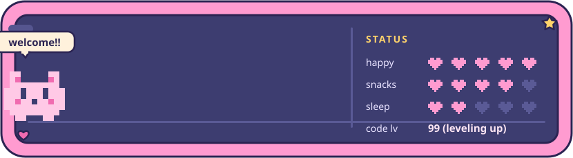

 

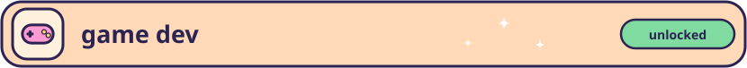

<a href="https://github.com/GoMunster/game-name">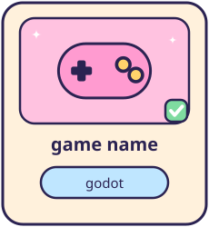</a> <a href="https://github.com/GoMunster/another-game">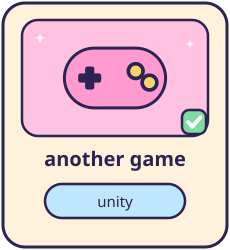</a> <a href="https://github.com/GoMunster/next-game">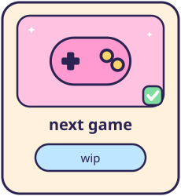</a> 

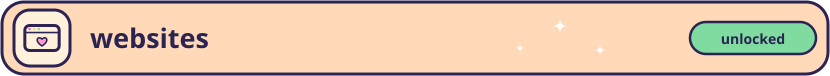

<a href="https://github.com/GoMunster/my-website">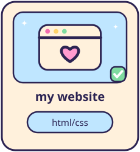</a> <a href="https://github.com/GoMunster/web-project">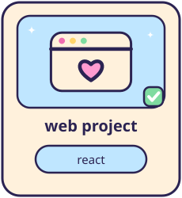</a> <a href="https://github.com/GoMunster/web-toy">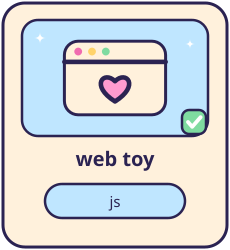</a> 

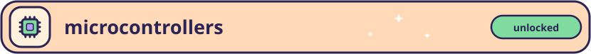

<a href="https://github.com/GoMunster/blinky-thing">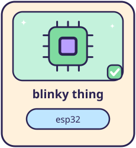</a> <a href="https://github.com/GoMunster/pocket-gadget">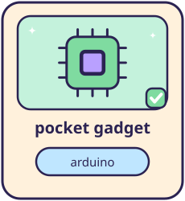</a> <a href="https://github.com/GoMunster/sensor-pal">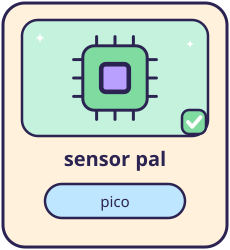</a> 

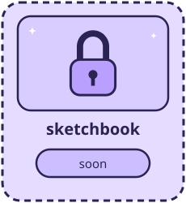 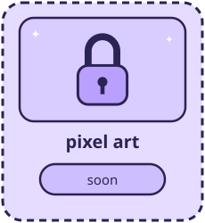 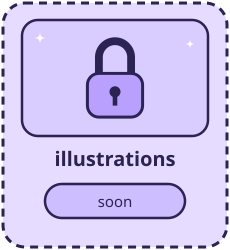 

the gallery is still loading ♡ sketches, pixel art & illustrations will unlock here

### ♪ my playlist (tools)

 

  

 

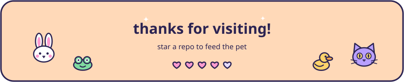

